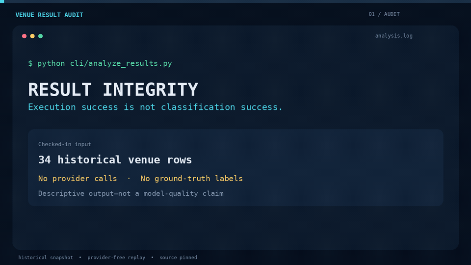

# categorization_embeddings_sementic_search

A venue-classification prototype combining OpenAI embeddings, semantic search,
and category selection against the Foursquare taxonomy. The repository includes
a historical 34-row result set that can be audited locally without provider keys.

## System Overview

This system processes venue data (name, address) and intelligently assigns the most appropriate Foursquare category using:
- OpenAI embeddings for semantic understanding
- Serper API search for real-world context enrichment  
- Cosine similarity matching for candidate selection
- OpenAI GPT-4 for intelligent final category selection
- Comprehensive LLM fallback mechanisms for robust error handling

## Checked-in historical result

Running `python cli/analyze_results.py` against the checked-in
`results/venue_category_matches.csv` reports:

- **34/34 executions completed**
- **17/34 rows contain a category** (50% observed coverage)
- **17/34 rows are explicit abstentions**
- **0 execution failures**

These are descriptive observations about a saved historical run. The dataset has
no ground-truth labels, so it cannot establish precision, accuracy, provider
quality, current live behavior, or production performance.

### Actual provider-free demo



[Watch the H.264 MP4](demo/venue-result-integrity.mp4) ·
[Inspect the capture receipt](demo/capture.json) ·
[Verify source provenance](demo/source-manifest.json)

The animation is rendered from an actual `python cli/analyze_results.py` replay
at the source commit recorded in the receipt. It depicts the saved historical
result only; it does not call providers or claim model quality.

## Quick Start

### Prerequisites
```bash
# Python 3.8+
pip install -r requirements.txt

# Required API Keys (add to .env file)
OPEN_AI_API_KEY=your_openai_api_key
SERPER_API_KEY=your_serper_api_key
```

### Basic Usage

#### 1. Generate Category Embeddings (One-time Setup)
```bash
python cli/embed_categories.py
```
Output: Pre-computed embeddings for all 1,245 Foursquare categories

#### 2. Classify All Venues
```bash
python process_all_venues.py
```
Input: `data/foursquare_categories - data.csv` (venue data)  
Output: `results/complete_venue_classification_results.csv` (classification results)

#### 3. Analyze Results
```bash
python cli/analyze_results.py
```
Output: execution status, observed classification coverage, and descriptive distributions

#### 4. Test System Components
```bash
python test_full_system.py
```
Output: Validation of all system components

## System Architecture

### Processing Pipeline

```
Venue Data → Search Enrichment → Generate Embedding → Find Top-4 Candidates → OpenAI Semantic Selection → Validate & Fallback → Final Classification
```

#### Step-by-Step Process

1. **Data Input**: Load venue data (name, address)
2. **Search Enrichment**: Query Serper API for business context
3. **Embedding Generation**: Create OpenAI embeddings for enriched text
4. **Candidate Selection**: Find top-4 similar categories using cosine similarity
5. **Intelligent Selection**: Use OpenAI GPT-4 for semantic category selection
6. **Validation & Fallback**: Validate results with multiple fallback layers
7. **Output Generation**: Save results with confidence scores and metadata

### Core Components

#### Intelligent Category Selector
- **Purpose**: OpenAI-powered semantic category selection
- **Features**: Context-aware prompts, response validation, fallback handling
- **Behavior**: returns a candidate label or an explicit abstention

#### Search Client
- **Purpose**: Enrich venue data with real-world business information
- **Features**: Query optimization, result caching, snippet extraction
- **Input**: venue queries sent to the configured search provider

#### Category Matcher
- **Purpose**: Efficient similarity-based candidate selection
- **Features**: Cosine similarity computation, top-k selection, memory optimization
- **Behavior**: ranks the checked-in taxonomy by cosine similarity

#### Embedding Generator
- **Purpose**: Generate OpenAI embeddings with caching and retry logic
- **Features**: Batch processing, exponential backoff, in-memory caching
- **Efficiency**: Optimized API usage with intelligent rate limiting

## File Structure and Purpose

### Configuration
```
config.py                    # Central system configuration
├── API keys and endpoints
├── Model configurations  
├── Processing parameters
└── File paths and settings
```

### Command-Line Tools
```
cli/
├── embed_categories.py      # Generate category embeddings (one-time setup)
├── classify_venues.py       # Individual venue classification pipeline
└── analyze_results.py       # Results analysis and reporting
```

### Core Business Logic
```
core/
├── embedding_generator.py   # OpenAI embeddings with caching & retries
├── search_client.py         # Serper API search with enrichment
├── category_matcher.py      # Cosine similarity matching engine
├── intelligent_category_selector.py  # OpenAI-powered semantic selection
└── llm_fallback.py          # Advanced fallback classification system
```

### Utility Modules
```
utils/
├── data_loader.py          # Robust data loading and validation
├── file_manager.py         # Safe file operations and I/O
└── logger_config.py        # Centralized logging configuration
```

### Data and Results
```
data/                       # Input datasets
├── foursquare_categories - foursquare_categories.csv  # Category taxonomy (1,245 categories)
└── foursquare_categories - data.csv                   # Venue data (34 venues)

results/                    # Generated outputs
├── foursquare_category_embeddings_embeddings.npy     # Category embeddings
├── foursquare_category_embeddings_metadata.json      # Category metadata
├── complete_venue_classification_results.csv         # Final classification results (34 venues)
├── venue_category_matches_with_llm_fallback.csv      # Results with fallback details
├── venue_category_matches.csv                        # Basic classification results
└── classification_analysis.json                      # Performance analysis
```

### Main Processing Scripts
```
process_all_venues.py        # Complete pipeline for all venues
test_full_system.py          # Comprehensive system validation
requirements.txt             # Python dependencies
```

## Advanced Usage

### Programmatic API
```python
from core.intelligent_category_selector import IntelligentCategorySelector, VenueInfo, CategoryCandidate

# Initialize system
selector = IntelligentCategorySelector()

# Create venue information
venue_info = VenueInfo(
    name="Starbucks Coffee",
    address="123 Main St, Seattle, WA",
    enriched_text="Popular coffee shop chain serving espresso drinks"
)

# Define category candidates (from similarity matching)
candidates = [
    CategoryCandidate(label="Dining and Drinking > Cafe, Coffee, and Tea House > Coffee Shop", score=0.85),
    CategoryCandidate(label="Business and Professional Services > Office > Corporate Coffee Shop", score=0.72)
]

# Get intelligent classification
result = selector.select_best_category(venue_info, candidates)
```

### Custom Configuration
```python
# config.py modifications
EMBEDDING_MODEL = "text-embedding-3-small"  # Current embedding model
CHAT_MODEL = "gpt-4"                        # Current GPT model
TOP_K_CANDIDATES = 4                        # Current candidate pool
API_DELAY_SECONDS = 0.5                     # Current rate limiting
```

## Error Handling and Fallbacks

### Multi-Layer Fallback System

#### Level 1: OpenAI API Failures
- Rate Limits: Exponential backoff with jitter
- Network Issues: Automatic retry with timeout handling
- Authentication: Graceful degradation to similarity-based selection

#### Level 2: Search API Failures
- Serper API Issues: Fallback to venue name/address only
- Network Timeouts: Use cached results when available
- Rate Limiting: Automatic delay and retry mechanisms

#### Level 3: LLM Fallback Processing
- Pattern Recognition: Indonesian business terms, common venue types
- Multi-stage Classification: Progressive refinement of categories
- Conservative Approach: Allow explicit abstention instead of forcing a category

#### Level 4: System Recovery
- Partial Failures: Continue processing remaining venues
- State Recovery: Resume from last successful classification
- Comprehensive Logging: Error tracking and debugging information

## Production Deployment

### Environment Setup
```bash
# Production environment
export OPENAI_API_KEY="your_provider_key"
export SERPER_API_KEY="your_production_key"
export LOG_LEVEL="INFO"
```

### Monitoring and reporting
- Execution status: track completed and failed processing separately
- Classification coverage: track classified and abstained rows separately
- API Usage Tracking: Monitor API call volumes and costs
- Error Rate Alerting: Automated alerts for system issues
- Runtime measurements: establish them in the target deployment before claiming performance

## System Highlights

- Explicit abstention: missing/sentinel categories are not counted as classifications
- Honest analysis: category and similarity distributions use classified rows only
- Provider boundary: live classification requires separately configured credentials
- Cost-Effective: Optimized API usage and caching strategies
- Maintainable: Clean code architecture with comprehensive documentation

## Portable local configuration

Data and results paths resolve from this checkout rather than a developer's
absolute home path. `OPENAI_API_KEY` is supported, with `OPEN_AI_API_KEY` retained
as a legacy alias. `SERPER_KEY` configures search enrichment.

Run local file-loading and candidate-ranking checks without credentials or
external requests:

```sh
python -m pytest -q tests/test_local_pipeline.py
```

Run the complete provider-free regression suite and regenerate the historical
analysis with:

```sh
python -m pytest -q
python cli/analyze_results.py
```

These checks validate local pipeline components and saved-result accounting.
Live embedding, search, and LLM classification require service credentials and
separate validation.
